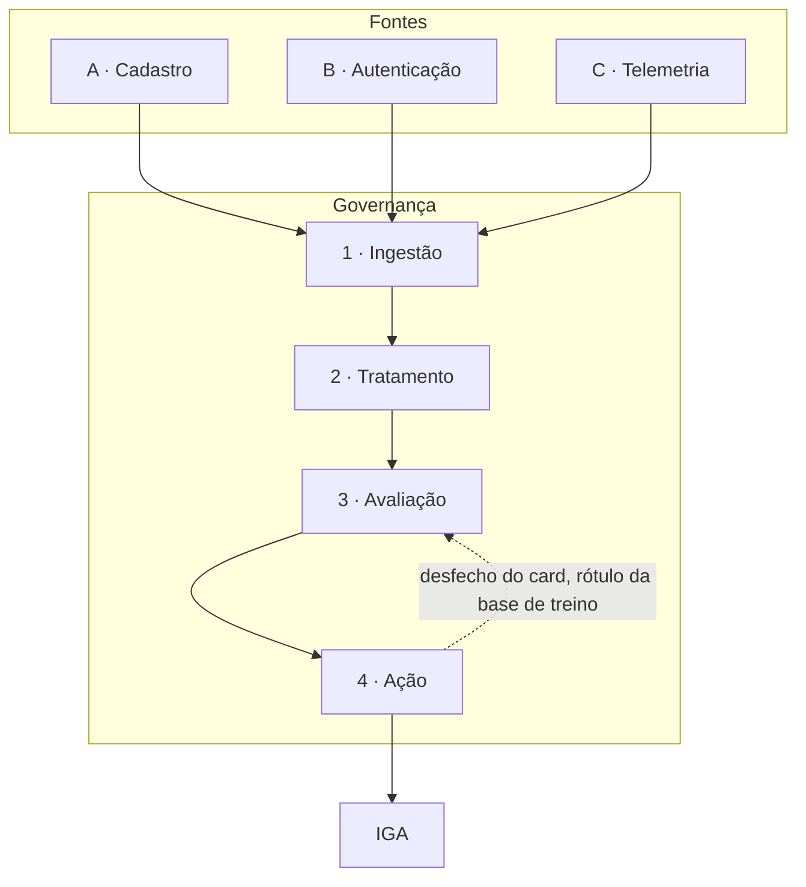

# Fluxo da ingestão até a ação

A solução é um fluxo único, com quatro etapas dentro da governança: ingestão, tratamento, avaliação e ação. A governança envolve as quatro. Ela acompanha qualidade, evolução e responsabilização em todas elas, e recebe o alerta quando um campo crucial chega ausente ou incompleto.

Cadastro, autenticação e telemetria entram na ingestão. O tratamento junta os registros da mesma identidade não-humana (NHI) pelo identificador único. A avaliação começa com um escore de regras e um limiar, para o card do time de tratamento já ir formando uma base de treino. A ação abre esse card e, quando a credencial vai mudar, coloca um email num fluxo de comunicação. Rotacionar, restringir e desativar só acontecem depois de um tempo hábil, para a operação continuar funcionando. A NHI pode ser gravada no IGA.

O enunciado pede identificar risco, classificar e priorizar cerca de 50 mil NHIs, levar o dado da ingestão até a ação, e medir e governar a solução no tempo. As decisões abaixo fecham o que o enunciado deixa em aberto: unicidade, campo ausente, motor inicial, card, email, IGA e o ciclo de criação, alteração e revogação.

Criação tem atenção na ingestão. Alteração tem atenção no tratamento e na avaliação. Revogação e gravação no IGA têm atenção na ação.

## Fontes

As fontes entram em três grupos, porque o enunciado separa o que descreve a NHI, o que descreve o segredo e o que descreve o uso. Os três existem espalhados entre on-premises e nuvem. O inventário não é de 100%, e parte do dado pode chegar incompleta ou inconsistente. As NHIs hoje não estão no IGA, então o IGA não é fonte desta ingestão.

**A · Cadastro** traz tipo, ambiente e provedor, sistema ou aplicação dona, natureza do uso, datas de criação e de último uso, responsável, privilégios e escopos, criticidade do sistema e se a credencial é rotacionada. Sem o cadastro, a solução não sabe o que a credencial é, quem responde por ela, nem a criticidade do que ela acessa.

**B · Autenticação** traz método, local do segredo, idade, data da última rotação, eventos de autenticação, existência de vários segredos ativos e o escopo do segredo apresentado. A NHI se autentica apresentando um segredo. O valor desse segredo não está na lista de informações do enunciado, então o fluxo trabalha com local, idade, rotação, multiplicidade e escopo.

**C · Telemetria** traz data do evento, origem, destino, tipo de operação, volume, resultado, protocolo, sequência e novidade. Sem a telemetria, uso fora do padrão fica invisível, e também ficam invisíveis comportamentos que o enunciado trata como legítimos, como pico sazonal, migração e cold start.

## 1. Ingestão

A ingestão reúne cadastro, autenticação e telemetria a partir de on-premises e nuvem, inclusive o registro incompleto. O registro incompleto entra de propósito: um campo que falta precisa continuar visível para a avaliação e para o alerta de governança. Descartar a linha incompleta esconderia justamente o buraco que a solução tem de enxergar.

Essa etapa existe porque a urgência do enunciado começa aqui. As NHIs estão fora do IGA, o inventário não é completo, e a revisão atual é anual, manual e restrita aos ambientes críticos. Ela não acompanha a velocidade com que credenciais novas nascem. A ingestão é o que permite ver o conjunto, e não só a amostra que o time dedicado revisa uma vez por ano.

Um identificador novo, que ainda não está na base, marca criação. Esse é o ponto de atenção do nascimento da NHI, detalhado mais abaixo.

## 2. Tratamento

O tratamento junta os registros da mesma NHI e deixa visível o que falta ou o que conflita entre as fontes. A mesma NHI pode ter vários segredos e aparecer em mais de um lugar: em código, em arquivo de configuração ou em mais de um sistema. Sem juntar esses registros, a avaliação olharia pedaços e não a credencial.

Uma mudança no registro já conciliado marca alteração. Privilégio, segredo, responsável, natureza do uso ou rotação que mudam fazem o registro único mudar, e a avaliação recalcula. Esse é o ponto de atenção da alteração.

Quando o campo existe, a natureza do uso segue junto. O enunciado diz que distinguir fluxo automatizado de NHI operada por pessoa importa, porque o que é normal num modo é sinal de risco no outro.

### Nota de arquitetura: unicidade

O identificador único é o critério de unicidade da base. Ele junta os registros de on-premises e nuvem da mesma NHI. A decisão é usar esse identificador como a chave, mesmo com dado inconsistente nas outras colunas.

Registro sem identificador não entra na base. Não há NHI para pontuar. Esse registro vira alerta de governança da ingestão, para a fonte passar a entregar a chave.

## Campo ausente

O efeito da ausência depende do campo.

Se o campo é crucial para a avaliação e chega ausente ou incompleto, a NHI sobe de risco e a ingestão recebe um alerta de governança. O alerta existe para a fonte ser corrigida. O aumento de risco existe para a NHI não passar pela fila como se o dado estivesse completo.

Se o campo é crucial só para executar a alteração da credencial, o risco não sobe. A alteração automática não começa, e a ingestão recebe o alerta. A avaliação ainda pode apontar a NHI por outro motivo. O que fica bloqueado é mudar a credencial sem saber o tipo, o ambiente ou o método.

Se o campo não é relevante para a avaliação nem para a alteração, não há proposta de resolução.

### Cruciais para a avaliação

Estes campos sustentam o risco ou a priorização que o enunciado pede. Sem eles, a avaliação não consegue separar uso normal de uso indevido, nem ordenar a fila por criticidade, exposição e movimentação lateral.

| Informação | Por que a avaliação usa | Se falta ou vem incompleta |
| --- | --- | --- |
| Natureza do uso | Separa fluxo automatizado de NHI operada por pessoa. O mesmo desvio é rotina num modo e risco no outro. | Aumenta o risco. Alerta de governança da ingestão. |
| Criticidade do sistema | É um dos três eixos de priorização do enunciado. | Aumenta o risco. Alerta de governança da ingestão. |
| Sistema ou aplicação dona | Define a finalidade original e qual operação uma alteração vai afetar. | Aumenta o risco. Alerta de governança da ingestão. A alteração automática não começa. |
| Privilégios e escopos | Sustentam acúmulo de privilégio e potencial de movimentação lateral. | Aumenta o risco. Alerta de governança da ingestão. |
| Escopo do segredo apresentado | Permite ver uso fora do escopo. | Aumenta o risco. Alerta de governança da ingestão. |
| Onde o segredo é armazenado | É o sinal de exposição: cofre, variável de ambiente, arquivo de configuração ou código. | Aumenta o risco. Alerta de governança da ingestão. |
| Rotação, idade ou última rotação | É o outro sinal de exposição. Credencial nunca trocada permanece válida. | Aumenta o risco. Alerta de governança da ingestão. |
| Múltiplos segredos ativos | Indica exposição e reutilização da mesma NHI. | Aumenta o risco. Alerta de governança da ingestão. |
| Responsável | O enunciado trata NHI sem dono como risco. O responsável também é quem recebe a comunicação antes de uma alteração. | Aumenta o risco. Alerta de governança da ingestão. Sem responsável, o fluxo automático não comunica e não altera. |
| Data de criação e de último uso | Separam credencial dormente reativada de credencial recém-criada. | Aumenta o risco. Alerta de governança da ingestão. |
| Evento: data, origem, destino, operação, resultado e autenticação | Sustentam uso fora do padrão, origem incompatível, falha atípica e mudança de fluxo automatizado para uso interativo. | NHI recém-criada sem histórico permanece no cold start do enunciado. Fora isso, aumenta o risco e alerta a ingestão. |

O enunciado não fixa quantos dias definem “recém-criada”. Enquanto esse prazo não existir, a regra mostra a data de criação e a ausência de histórico, e o card do time confirma se aquele caso é cold start.

### Cruciais para alterar a credencial

Estes campos não entram no cálculo do risco. Eles entram na hora de executar rotacionar, restringir ou desativar. Sem eles, a alteração automática não tem como acontecer com segurança.

| Informação | Por que a ação usa | Se falta ou vem incompleta |
| --- | --- | --- |
| Tipo da NHI | Service account, API key, token e certificado não se alteram do mesmo modo. | Não aumenta o risco. A alteração automática não começa. Alerta de governança da ingestão. |
| Ambiente e provedor | Diz onde a alteração é aplicada: on-premises, cloud A ou cloud B. | Não aumenta o risco. A alteração automática não começa. Alerta de governança da ingestão. |
| Método de autenticação | Diz como o segredo é trocado, restringido ou desativado. | Não aumenta o risco. A alteração automática não começa. Alerta de governança da ingestão. |

### Sem proposta quando faltam

Estes campos enriquecem a leitura quando existem. A ausência deles não gera card, email nem alerta.

| Informação | Por que não gera proposta |
| --- | --- |
| Periodicidade da rotação | A avaliação já usa se a credencial rotaciona e a data da última rotação. |
| Volume de chamadas | O volume sai dos eventos quando data, origem e destino existem. |
| Protocolo ou serviço | Não é eixo de priorização nem condição da alteração. |
| Sequência das operações | Privilégio e destino já sustentam o potencial de movimentação lateral. |
| Novidade pronta | Origem, destino e operação nunca vistos saem do histórico desses eventos. |

## 3. Avaliação

O motor inicial é um escore de regras com limiar. Cada regra que dispara entra no motivo, com os campos que a fizeram disparar. Campo crucial ausente aumenta o risco. A fila ordena as NHIs por criticidade do que a credencial acessa, exposição do segredo e potencial de movimentação lateral. Só a NHI acima do limiar segue para a ação. As outras permanecem na base, acompanhadas, sem abrir card.

### Por que regras e limiar, com o objetivo de uma base treinada em breve

O enunciado não envia uma base rotulada. Não há, no material do case, um histórico em que cada NHI já esteja marcada como risco ou como uso legítimo. Um modelo de aprendizado de máquina precisa desse rótulo para ser treinado. Começar pelo modelo atrasaria a primeira fila.

O motor de regras produz uma decisão justificável desde o primeiro ciclo. Rotacionar, restringir e desativar se explicam pela regra que disparou, que é o que o enunciado exige: o time precisa entender por que a NHI foi sinalizada.

A base de treino nasce do desfecho do card do time de tratamento. Ao fechar o card, o time registra se o risco se confirmou, se o caso era legítimo, se a NHI entrou em whitelist ou blacklist, e qual ação foi executada. Esses rótulos se acumulam a partir dos primeiros cards. O modelo da plataforma interna de dados entra quando essa base existir. Até lá, a decisão continua sendo a regra.

O trade-off é direto. A regra cobre as oito situações de risco do enunciado e não enxerga um padrão novo até o time marcar o card. A explicação de cada alteração fica explícita. Um modelo treinado nessa base pode, numa etapa seguinte, passar a reconhecer o que as regras ainda não nomeiam. A plataforma interna também oferece IA generativa. Ela não decide a alteração da credencial nesta versão: a justificativa precisa ser a regra e os campos, não um texto gerado.

O enunciado não fixa o valor do limiar. A atividade da avaliação é separar quem segue para a ação. O número do corte fica para calibrar com o tamanho de fila que o time de tratamento consegue tratar. Cinquenta mil linhas não são uma ação.

### Atividades

1. **Receber o registro único.** Entra o que o tratamento conciliou pelo identificador, com a marca do campo que falta. A avaliação não busca a fonte de novo.
2. **Aplicar as regras de risco.** Confere as oito situações do enunciado com os campos que existem para cada uma.
3. **Segurar o que o enunciado trata como legítimo.** Natureza operada por pessoa, rotação já registrada, cold start e aumento só de volume não abrem ação sozinhos.
4. **Somar ausência crucial.** Campo crucial incompleto aumenta o risco e segue como alerta de governança da ingestão.
5. **Ordenar a fila.** Criticidade, exposição e potencial de movimentação lateral definem quem vem antes entre as NHIs que as regras apontaram.
6. **Emitir o pacote.** Acima do limiar, sai um pacote com identificador, regras, ações indicadas e a informação de se a alteração automática pode começar.
7. **Guardar o rótulo.** O desfecho do card volta para a governança e alimenta a base de treino. O próximo ciclo de avaliação já pode usar esse histórico como contexto do time, e a base fica disponível para o modelo futuro.

### O que entra

| Entrada | Uso no motor |
| --- | --- |
| Identificador único | Chave da NHI na fila e na base de treino. |
| Campos cruciais e a marca de ausência | Risco pelo conteúdo do campo e aumento de risco quando o campo falta. |
| Tipo, ambiente e método | O pacote informa à ação se a credencial pode ser alterada. |
| Natureza do uso | NHI operada por pessoa não dispara regra por horário ou volume irregular. Se o campo falta, o risco sobe. |
| Responsável, sistema, criticidade, privilégio e escopo | Órfã, finalidade original, prioridade e movimentação lateral. |
| Local do segredo, rotação, idade e segredos múltiplos | Exposição. |
| Criação, último uso, origem, destino, operação, resultado e autenticação | Dormente reativada, origem, escopo excedido, falha atípica, mudança de natureza e cold start. |

### O que sai, e como chega na ação

Sai um pacote por NHI acima do limiar. A etapa de ação abre um card com esse pacote. Se há responsável e a ação indicada altera a credencial, a ação também coloca um email no fluxo de comunicação.

| Campo do pacote | Para que a ação usa |
| --- | --- |
| Identificador | Card, email e registro no IGA. |
| Regras disparadas | Motivo, no card e no email. É a explicação exigida pelo enunciado. |
| Ações indicadas | Rotacionar, restringir, desativar, ou nenhuma alteração de credencial. |
| Campos cruciais ausentes | O card mostra o buraco. A governança da ingestão já recebeu o alerta. |
| Pode alterar automaticamente | Sim quando há responsável, sistema, tipo, ambiente e método, e a NHI não está na whitelist. |

### Regra inicial e ação indicada

A correspondência abaixo é a proposta inicial. Ela liga cada situação do enunciado à alteração que trata a causa, e mantém a alteração explicável.

| Situação do enunciado | Ação indicada |
| --- | --- |
| Segredo em código, em configuração ou em mais de um sistema; vários segredos ativos; sem rotação | Rotacionar. O problema está no segredo. |
| Escopo excedido, ou privilégio amplo com acesso fora do sistema dono | Restringir. O problema está no que a credencial pode fazer. |
| Dormente reativada; origens incompatíveis; falhas de autenticação e depois um sucesso; fluxo automatizado que passa a padrão interativo | Desativar. O uso é compatível com comprometimento. Desativar é a revogação. |
| Sem responsável | Nenhuma alteração até o card ter um responsável. Se a exposição também disparar, rotacionar fica indicado e espera esse responsável. |
| Só campo crucial ausente, sem situação de risco | Nenhuma alteração de credencial. O card mostra o campo. O alerta fica na governança da ingestão. |

Uma NHI pode disparar mais de uma regra. O card leva todas. O email, quando existe, descreve cada alteração de credencial. Se falta responsável, nenhuma delas começa até o card atribuir alguém.

### O que o motor não trata como risco sozinho

O enunciado lista comportamentos que parecem risco e são legítimos. A versão inicial lida com eles assim:

- **Pico sazonal.** Nenhuma das oito regras é só “o volume subiu”. Aumento de volume, isolado, não abre ação.
- **Migração de infraestrutura.** O enunciado não traz um campo de migração. Origem nova pode disparar regra de dormente ou de origem. O time marca o card como legítimo, e esse rótulo entra na base de treino.
- **Cold start.** NHI recém-criada, sem histórico, não dispara regra de comportamento. Campo crucial ausente ainda aumenta o risco, porque falta de histórico e falta de campo são coisas diferentes. O enunciado não fixa o prazo de “recém-criada”.
- **Contingência e disaster recovery.** O enunciado não traz um campo de disaster recovery. A whitelist tira essa NHI da alteração automática.
- **Rotação recente.** Uma troca já registrada na data da última rotação não abre desativação sozinha. O enunciado não fixa o prazo de “recente”.
- **NHI operada por pessoa.** Irregularidade de horário e volume não dispara regra. As regras de segredo, privilégio, escopo e responsável continuam valendo.

### O que o enunciado não fixa

O motor mostra os campos e o card confirma, enquanto estes cortes não estiverem definidos:

- o valor do limiar da fila;
- o período que caracteriza uma NHI dormente;
- o critério que torna duas origens incompatíveis;
- o prazo de cold start;
- o prazo de rotação recente.

## 4. Ação

Toda NHI acima do limiar abre um card para o time de tratamento. O card é o lugar em que o time vê o motivo e o que fazer a seguir.

O email existe para alimentar um fluxo de comunicação das ações. Ele não é um envio solto. Entra nesse fluxo, que conduz a sequência de comunicações até o responsável e segura a alteração pelo tempo hábil, para a operação continuar funcionando com a mudança na NHI. Rotacionar, restringir e desativar passam por esse fluxo quando há responsável.

Sem responsável, o card pede a atribuição e a credencial permanece como está. Não há email, porque não há destinatário, e não há alteração.

O enunciado não fixa o prazo do tempo hábil nem a quantidade de emails da sequência. O canal definido para esse fluxo é o email.

### Atividades

1. **Receber o pacote** da avaliação: identificador, motivo, ações indicadas e campos ausentes.
2. **Abrir o card** para o time de tratamento, com o porquê e o próximo passo.
3. **Alimentar o fluxo de comunicação** com um email, quando há responsável e a credencial vai mudar.
4. **Ler whitelist e blacklist.** Whitelist impede a alteração. Blacklist coloca a NHI no caminho automático.
5. **Alterar a credencial.** No caminho automático, depois do tempo hábil do fluxo de comunicação. Sem blacklist, o time altera a partir do card, também depois desse fluxo, quando a alteração existe e há responsável.
6. **Gravar no IGA** o identificador, o motivo, a prioridade e o que foi decidido ou executado.
7. **Devolver o desfecho** do card para a governança. Esse fechamento é o rótulo da base de treino.

No caminho automático, o card continua existindo como registro do que foi apontado e do que o fluxo vai fazer. O time não executa uma segunda alteração por cima da automática. Sem blacklist e sem whitelist, quem executa é o time, a partir do card.

### Ações possíveis

| Ação | Quando acontece |
| --- | --- |
| Card para o time de tratamento | Toda NHI acima do limiar. Na whitelist, o card permanece e a alteração não ocorre. O time ainda vê por que a NHI foi apontada. |
| Email no fluxo de comunicação | Há responsável e a ação indicada é rotacionar, restringir ou desativar. O fluxo conduz a sequência e o tempo hábil antes da alteração. |
| Rotacionar | Exposição do segredo: código, configuração, mais de um sistema, vários segredos ativos ou ausência de rotação. Espera responsável e tempo hábil. |
| Restringir | Privilégio ou escopo além do propósito. Espera responsável e tempo hábil. |
| Desativar | Uso compatível com comprometimento. É a revogação da NHI. Espera responsável e tempo hábil. |
| Whitelist | O time sinaliza no card. A NHI sai da alteração automática. |
| Blacklist | O time sinaliza no card. A alteração segue o caminho automático depois dos emails. |
| Gravar ou atualizar no IGA | Toda NHI que chega na ação, tanto pelo card quanto pelo caminho automático. |

### Card

O card leva o identificador, o sistema dono, a criticidade, a natureza do uso, as regras que dispararam, as ações indicadas, os campos ausentes e o próximo passo. É o que o enunciado pede para o time: entender por que a NHI foi sinalizada e o que fazer, sem interromper processo produtivo.

No card, o time pode confirmar o risco, marcar o caso como legítimo, sinalizar whitelist ou blacklist, atribuir responsável quando ele falta, e executar rotacionar, restringir ou desativar quando não há blacklist. A execução pelo time também espera o fluxo de comunicação, se houver responsável e se a credencial for mudar.

O fechamento do card grava o desfecho. Esse desfecho volta para a avaliação como rótulo.

### Email e fluxo de comunicação

O email entra no fluxo de comunicação das ações. O destinatário é o responsável da NHI. O conteúdo diz qual é a NHI, qual alteração está prevista e que há tempo hábil antes dela acontecer.

O fluxo, e não o email isolado, faz a sequência. Mais de uma comunicação pode ocorrer antes da alteração. O fluxo é o que impede rotacionar, restringir ou desativar no mesmo instante em que o card abre. A condição é o tempo hábil para a operação absorver a mudança. O enunciado exige que ação sobre autenticação não interrompa integração e processo legítimo em produção.

Whitelist não gera email de alteração, porque não há alteração. Ausência de responsável também não gera email.

### Whitelist e blacklist

O fluxo automático é um caminho possível, não o destino de toda NHI priorizada.

- **Whitelist** deixa a NHI fora da alteração automática. O card continua, para o apontamento não sumir.
- **Blacklist** coloca a NHI no caminho automático. Depois da sequência de emails e do tempo hábil, a alteração indicada é executada, desde que responsável, sistema, tipo, ambiente e método existam.
- **Sem as duas sinalizações,** a proposta fica com o time de tratamento. O time executa a partir do card, com o mesmo fluxo de comunicação quando a credencial vai mudar.

Essas sinalizações são o controle que o enunciado não nomeia e que a solução precisa para não alterar credencial de contingência, de fechamento ou de disaster recovery como se fosse incidente, e para deixar o caminho automático disponível quando o time já confirmou o caso.

## Governança

A governança não é uma quinta etapa depois da ação. Ela engloba ingestão, tratamento, avaliação e ação.

Na ingestão, ela recebe o alerta de campo crucial ausente ou incompleto, e o alerta de registro sem identificador. Na avaliação, ela guarda a qualidade da fila: o que a regra apontou e o que o time confirmou ou marcou como legítimo. Na ação, ela acompanha quem sinalizou whitelist ou blacklist, quem é o responsável que recebeu o email, e qual alteração foi executada. O desfecho do card, ao voltar como rótulo, é o mecanismo de evolução: a base de treino cresce com o uso, e o modelo da plataforma interna só entra em cima desses rótulos.

O enunciado pede medir sucesso e governar qualidade, evolução e responsabilização. Esta versão localiza esses três acompanhamentos na governança, sem fixar ainda os números de sucesso. Os números dependem do limiar e do prazo, que o enunciado também não fixa.

## Nota de arquitetura: atuação do IGA

O enunciado diz que as NHIs não estão no IGA, a plataforma de governança de identidades, e que não há inventário de 100%. Neste controle, o IGA passa a guardar a NHI e o que o fluxo decidiu sobre ela: identificador, motivo, prioridade e a alteração decidida ou executada.

Enquanto o inventário estiver fora do IGA, ele não é fonte da ingestão. As fontes continuam sendo cadastro, autenticação e telemetria, em on-premises e nuvem. A gravação no IGA acontece na ação, para toda NHI que o limiar entrega ao time. Na criação, essa gravação também registra a NHI nova, para ela deixar de nascer fora da governança.

O IGA, neste desenho, é o sistema de registro do controle. Ele não provisiona a credencial no ambiente e não substitui o card nem o fluxo de comunicação.

## Nota de arquitetura: criação, alteração e revogação

O ciclo de vida da NHI tem atenção em pontos diferentes do fluxo. Não é uma etapa extra.

**Criação** tem atenção na ingestão e na gravação no IGA. Um identificador que ainda não está na base entra como NHI nova. O tratamento abre o registro único. A avaliação, se não houver histórico, trata o caso como cold start: não dispara regra de comportamento só pela falta de passado. Campo crucial ausente, mesmo numa NHI nova, aumenta o risco e alerta a ingestão. A ação grava o registro no IGA, para a credencial passar a existir na governança de identidades. Se a NHI nova também passar do limiar, o card e, quando couber, o email seguem as regras já descritas.

**Alteração** tem atenção no tratamento e na avaliação, e a atualização no IGA acontece na ação. Mudança de privilégio, segredo, responsável, natureza do uso ou rotação muda o registro único. O motor recalcula. Uma rotação já registrada na data da última rotação não abre desativação sozinha. Se o novo resultado passar do limiar, sai um pacote novo para a ação, com card, email se houver alteração de credencial e responsável, e atualização do IGA.

**Revogação** tem atenção na ação. Ela é o desativar. Só ocorre depois do card e do tempo hábil do fluxo de comunicação, e só começa quando há responsável, sistema, tipo, ambiente e método. O IGA recebe o estado revogado. Whitelist impede essa revogação automática. Sem responsável, o card pede a atribuição e a credencial não é revogada.

| Momento | Etapa com atenção | O que acontece |
| --- | --- | --- |
| Criação | Ingestão, e gravação no IGA pela ação | Identificador novo entra na base. O IGA recebe o registro. Sem histórico, a avaliação trata como cold start. |
| Alteração | Tratamento e avaliação; o IGA é atualizado na ação | O registro único muda e o motor recalcula. Rotação já registrada não abre desativação sozinha. |
| Revogação | Ação | Desativar, depois do card e do tempo hábil do email. O IGA recebe o estado revogado. |
