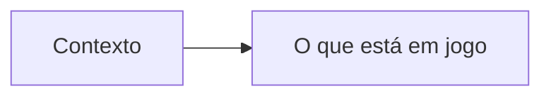

# Título do cenário

<!--
Orientações deste modelo. Não copie estes comentários para o arquivo do cenário.
- Cenário: a situação, descritiva, com um diagrama quando o fluxo, os sistemas ou as pessoas importam.
- Pergunta: o que o entrevistador questiona.
- Resposta: a resposta que eu dou.
-->

## Cenário

## Pergunta

## Resposta
